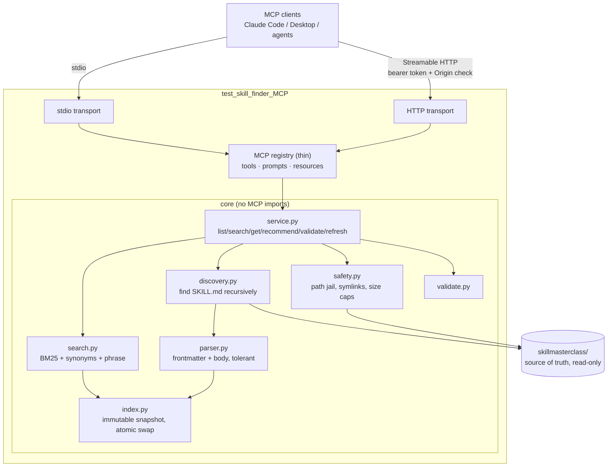

# SkillMasterclass MCP Server – Plan

Status: **plan only, no server code written yet.** The only change made so far is the skill inventory (section 2).

## 1. Goal
A FastMCP server that lets an LLM discover, search, retrieve and apply the skills in `MCP_Create_VIBE/skillmasterclass/` by keyword, phrase or task description (for example "Playwright API testing", "test plan creator", "analyze production defect"). Adding, editing or removing a skill must never require a core code change.

## 2. Audit of the current repository

| Item | Finding |
|---|---|
| Skills root | `MCP_Create_VIBE/skillmasterclass/` (confirmed; the copy I made earlier under `AIMastery/skillmasterclass` was identical and has been deleted) |
| Server project folder | `MCP_Create_VIBE/test_skill_finder_MCP/` (empty; created by you) |
| Stack | Python 3.13; FastMCP 4.1.0, PyYAML 6.0.3, pytest 9 + pytest-asyncio, starlette/uvicorn already installed. Same stack as `testcase_finder_MCP`, so reuse it. |
| Original skills | **36** (14 STLC skills in folders `01-` to `07-`, 11 in `framework-packs/playwright-pack`, 11 in `framework-packs/selenium-pack`) |
| Frontmatter convention | `name`, `description` (folded `>-`), `license`, `metadata{author, stlc-phase, version}`. **No `tags` or `category` field exists**, so they must be derived and flagged as inferred. |
| Supporting files | Only `test-plan-generator` has them: `references/` (2 files), `scripts/fetch_jira.sh`, `copilot/test-plan.prompt.md`. Scripts must never be executed. |
| Malformed / duplicate | 0 malformed, 0 duplicate names (checked by parsing all frontmatter) |
| Existing MCP tools / tests | None for skills. Existing `testcase_finder_MCP` is unrelated and stays untouched. |

### Inventory work already done (needs your confirmation)
To reach the 50-skill minimum I already created **21 new skills** (one `SKILL.md` each, same format, no placeholders), so the library is now **57**. They sit in the existing phase folders plus two new ones: `08-ai-testing/` and `09-code-quality/`.

| Folder | New skills |
|---|---|
| 01 | requirements-traceability-matrix |
| 02 | test-strategy-creator, risk-based-test-planner, test-estimation-planner |
| 03 | api-contract-tester, database-test-designer, performance-test-designer, security-test-designer, accessibility-test-designer, mobile-test-designer |
| 05 | exploratory-testing-charter, smoke-sanity-suite-builder, ci-cd-test-integrator |
| 06 | defect-trend-analyzer |
| 07 | release-readiness-assessor, quality-metrics-dashboard |
| 08 (new) | llm-prompt-evaluator, rag-application-tester, ai-agent-tester, ai-test-case-evaluator |
| 09 (new) | test-automation-code-reviewer |

No existing skill was modified. If you'd rather review or reduce these first, say so; they are plain files and easy to remove.

**Known gaps** against your suggested list (not required for the 50 minimum; optional later): WebdriverIO, pytest framework, integration/microservices/message-queue testing, data-pipeline testing, compatibility testing, REST API testing as a standalone skill (`api-test-designer` and `pw-api-tester` cover most of it).

## 3. Decisions to confirm (my recommendations)
1. **Python + FastMCP 4.1** (reuse existing stack and tests approach). FastMCP supports stdio and Streamable HTTP, tools, prompts and resource templates.
2. **Skill ID = frontmatter `name`** (lower-case, unique). Fallback to the folder name if `name` is missing, with a validation warning. Duplicates are reported by `validate_skills`; the first in sorted path order wins and the rest are excluded from the index.
3. **Category** is derived from the parent folder (`03-test-design` -> "Test Design"; packs -> "Playwright" / "Selenium") and cross-checked with `metadata.stlc-phase`. Reported as `category_source: inferred`.
4. **Tags** are derived from name tokens plus a small keyword extraction from the description, flagged `tags_source: inferred`. Real `tags` frontmatter is used if a skill ever adds one.
5. **Search**: own pure-Python BM25 over name, description, tags, category and body, with field weights (name > description/tags > body), stemming, phrase bonus and **a synonym/query-expansion file** (see 6). No external service. Semantic search is an optional plug-in, off by default.
6. **Synonyms in config, not code**: `config/synonyms.yaml` maps generic terms to each other (creator/writer/generator/author, defect/bug, plan/planning, framework/scaffold, E2E/end-to-end, API/REST). This is what makes "test case creator" find `test-case-writer` and "test plan creator" find `test-plan-generator`. It contains no skill names.
7. **Resource URI scheme**: `skillmasterclass://catalog`, `skillmasterclass://skills/{skill_id}`, `skillmasterclass://skills/{skill_id}/meta`, `skillmasterclass://skills/{skill_id}/files/{path}`.
8. **HTTP security**: bind `127.0.0.1` by default; bearer-token auth required for any other bind (server refuses to start otherwise); Origin check; request size limit.
9. **Read-only by default for refresh**: `refresh_skill_index` can be disabled by config for untrusted clients.

## 4. Architecture



Key rules:
- The index is an **immutable snapshot** built off to the side and swapped in atomically; a failed refresh keeps the previous snapshot. A lock prevents concurrent rebuilds.
- Retrieval reads the file at request time through the path jail; the index stores metadata and searchable text, not a second copy to keep in sync.
- Skill text is returned as **data**; the server never executes scripts and never lets skill content change server policy.
- stdout carries protocol only on stdio; logs go to stderr.

### Proposed layout
```
test_skill_finder_MCP/
  skillfinder_mcp/
    config.py  server.py  http_app.py
    core/ discovery.py parser.py index.py search.py service.py safety.py validate.py
    mcp_api/ tools.py prompts.py resources.py
  config/synonyms.yaml
  tests/
  README.md  requirements.txt  pytest.ini
```

## 5. Tools (generic, none per-skill)
| Tool | Key inputs | Returns |
|---|---|---|
| `list_skills` | category?, keyword?, limit, offset | id, name, description, category, tags, path; total and next offset |
| `search_skills` | query, category?, limit, search_mode (`keyword` default, `semantic` optional) | ranked results with score and "why it matched" |
| `get_skill` | skill_id or unique name | metadata, full `SKILL.md`, resource list |
| `get_skill_details` | skill_id | metadata only, with inferred fields marked |
| `get_skill_resources` | skill_id, path? | list, or one file's content (text only, size-capped) |
| `recommend_skills` | task, max_results | ordered skills, scores, reasons, suggested order of use (by STLC phase) |
| `validate_skills` | none | errors, warnings, affected ids, suggestions; never modifies files |
| `get_skill_catalog` | category?, limit, offset | totals, valid count, per-category counts, short entries, validation status |
| `refresh_skill_index` | none | added / changed / removed / failed; disabled when refresh is off |
| `list_skill_categories` | none | categories with counts |
| `find_related_skills` | skill_id, limit | neighbours by shared terms and adjacent STLC phase |
| `get_skill_statistics` | none | counts, resource totals, index build time/size |

Errors are structured (`not_found`, `ambiguous` with candidate ids, `invalid_path`, `too_large`, `refresh_disabled`).

## 6. Search design
1. Tokenize, lower-case, light stemming (own suffix stripper, no dependency).
2. Query expansion from `synonyms.yaml` at reduced weight.
3. BM25F-style scoring: name x4, tags/category x2.5, description x2, body x1; phrase and exact-name bonuses; partial-prefix matching.
4. Return `reason` listing matched fields and terms.
5. `recommend_skills` splits a long task into facets (framework, auth, reporting, CI/CD...), takes the best skills per facet, de-duplicates, and orders by STLC phase. It only returns indexed skills.

Expected behaviours I will turn into tests against the real library:
| Query | Should surface |
|---|---|
| Playwright | the `pw-*` pack |
| Playwright API testing | `pw-api-tester` first |
| test case creator | `test-case-writer` |
| test plan creator | `test-plan-generator` |
| test strategy | `test-strategy-creator` |
| analyze production defect | `rca-analyzer`, `bug-triage-assistant`, `defect-trend-analyzer` |
| create an end-to-end automation framework | `se-framework-scaffolder`, `ci-cd-test-integrator`, `pw-ci-configurator`, `pw-fixture-designer` |

If any of these miss, the fix goes into scoring or `synonyms.yaml`, never into skill-specific code.

## 7. Prompts (12, thin and generic)
`find_skill_for_task`, `generate_test_cases`, `create_test_plan`, `create_test_strategy`, `design_playwright_tests`, `design_playwright_api_tests`, `review_test_automation_framework`, `analyze_defect`, `perform_root_cause_analysis`, `analyze_test_coverage`, `evaluate_llm_application`, `review_test_results`.
Each prompt tells the model to: state objective and constraints, call `search_skills`/`recommend_skills`, `get_skill` the chosen skill(s), use `get_skill_resources` if needed, apply the instructions, list assumptions and missing info, and never invent skills. Prompts contain no skill text.

## 8. Resources
Catalog, per-skill content, per-skill metadata, and supporting files via templates (URIs in section 3). Listing reflects the live index; unknown or deleted ids give a clear not-found error; all reads go through the path jail.

## 9. Safety rules
- Resolve every path against the skills root with `realpath`; reject absolute paths, `..`, null bytes, and anything resolving outside the skill's own directory (or an optional configured shared directory).
- Symlinks: reject by default.
- Caps: max file size (default 1 MB), max results, max HTTP body.
- Only text files returned; binaries listed but not read.
- Malformed frontmatter -> that skill gets a warning/error; the server keeps running.
- Skill content is never treated as instructions to the server; `.sh` files are listed, never run.
- Missing/invalid skills root -> startup fails with a clear configuration error; no silent fallback.

## 10. Configuration (env vars, validated at startup)
`SKILLMASTERCLASS_ROOT` (default: `../skillmasterclass` resolved from the package file, never from cwd), `SKILLFINDER_TRANSPORT` (stdio|http), `SKILLFINDER_HOST` (127.0.0.1), `SKILLFINDER_PORT`, `SKILLFINDER_HTTP_PATH` (/mcp), `SKILLFINDER_AUTH_TOKEN`, `SKILLFINDER_ALLOWED_ORIGINS`, `SKILLFINDER_LOG_LEVEL`, `SKILLFINDER_SEARCH_MODE`, `SKILLFINDER_REFRESH_ENABLED`, `SKILLFINDER_MAX_FILE_BYTES`, `SKILLFINDER_SYNONYMS_FILE`.

## 11. Test plan (pytest, real MCP client in-memory plus real subprocess/HTTP)
| Area | Examples |
|---|---|
| Discovery/parsing | nested dirs, empty dir, missing root, malformed frontmatter, unreadable file, duplicate names (using temp skill trees) |
| Inventory | >= 50 valid skills, no duplicates, no empty bodies, ids match directories |
| Search | the 8 queries above against the real library, case-insensitivity, partial/phrase, category filter, ranking order, pagination, empty results |
| Retrieval | full skill, metadata, missing/ambiguous id, unicode, resources |
| Security | traversal, absolute paths, symlink, oversize, outside-root access, HTTP without/with wrong token |
| Protocol | list/call tools, prompts, resources, bad input validation |
| Refresh | add / modify / remove skill, partial failure keeps last good index |
| Transport | real stdio subprocess; real HTTP server; startup config validation; stdout stays clean |
| Regression | `testcase_finder_MCP` tests still pass |

Results will be reported exactly as run, including any failures.

## 12. Build phases
1. **Inventory** (done: 57 skills) – confirm or adjust.
2. **Core**: config, discovery, parser, safety, index, search, service, validate (+ unit tests).
3. **MCP layer**: tools, prompts, resources (+ in-memory protocol tests).
4. **Transports**: stdio, then HTTP with auth/origin/limits (+ subprocess/HTTP tests).
5. **Verify**: run full tests, run the 8 queries, try in Claude Code and, if you want, Claude Desktop (using the `PYTHONPATH` approach that worked before).
6. **Docs**: README (all 20 items from your list), client config snippets, final implementation report with real counts and test results.

## 13. Decisions (confirmed 2026-10-10)
1. **Keep the 21 added skills** (library = 57), left where they are now (existing phase folders plus `08-ai-testing/` and `09-code-quality/`). Do not move or modify them; original 36 skills are not modified either.
2. **Server folder:** `test_skill_finder_MCP/`.
3. **Semantic search:** documented, pluggable, **off by default**; keyword search is the only built-in mode in v1.
4. **HTTP:** localhost-only bind plus bearer-token auth; no hosting planned.
5. **Missing optional skills** (WebdriverIO, pytest, integration/microservices, data pipeline, compatibility): **later**.

**All open questions resolved. Ready to build on your go-ahead.**
