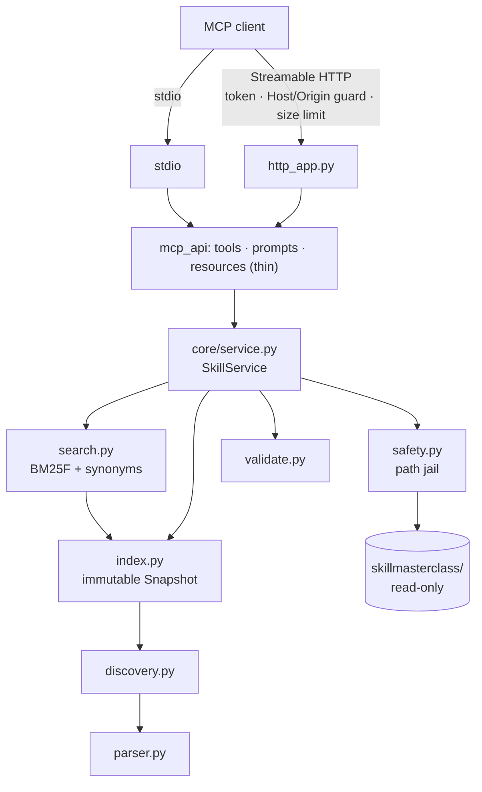

# SkillMasterclass MCP Server (`test_skill_finder_MCP`)

## 1. Overview
An MCP server (Python, FastMCP 4.1) that lets LLMs and agents **discover, search, retrieve and apply** QA/testing skills from `../skillmasterclass/`. Each skill is a folder with a `SKILL.md`; the server indexes them dynamically, so adding, editing or removing a skill needs **no code change** (just `refresh_skill_index` or a restart).

- 57 skills indexed today (36 original + 21 added), 0 validation errors.
- Keyword search with ranking and reasons; no external AI service needed.
- 12 tools, 12 prompts, catalog + per-skill resources.
- stdio and Streamable HTTP (localhost + bearer token) from the same core.

## 2. Architecture

Business logic lives in `core/` and has no MCP imports; both transports call the same `SkillService`.

## 3. Repository structure
```
MCP_Create_VIBE/
  skillmasterclass/                  # source of truth (skills)
  test_skill_finder_MCP/
    skillfinder_mcp/
      __main__.py  server.py  http_app.py  config.py
      core/      discovery.py parser.py index.py search.py service.py safety.py validate.py errors.py
      mcp_api/   tools.py prompts.py resources.py
    config/synonyms.yaml             # generic query vocabulary (no skill names)
    tests/                           # 95 tests
    01_SkillFinderMCP_plan.md  IMPLEMENTATION_REPORT.md  requirements.txt  pytest.ini
```

## 4. Skill directory conventions
- Any folder under the root containing `SKILL.md` is a skill; nesting depth is free.
- Frontmatter (YAML between `---` lines): `name` (required in practice; folder name used as fallback), `description`, optional `license`, `metadata{...}`, `category`, `tags`.
- **Skill id** = normalized `name` (lower-case, non-alphanumerics -> `-`). Must be unique.
- **Category**: frontmatter `category` if present, else inferred from the parent folder (`03-test-design` -> "Test Design", `playwright-pack` -> "Playwright Pack"). Reported with `category_source`.
- **Tags**: frontmatter `tags` if present, else inferred from id + category (`tags_source: inferred`).
- Other files in the skill folder are **supporting resources**. A nested folder with its own `SKILL.md` is a separate skill.

## 5. Discovery and indexing flow
1. Walk the root (symlinks not followed; hidden dirs skipped) and collect `SKILL.md` files.
2. Parse each one: frontmatter + original Markdown; size-capped; malformed files become validation errors, the rest still load.
3. Build a `Snapshot` (skills + BM25F index) off to the side.
4. Swap it in atomically. Refresh is lock-protected; if a rebuild fails, the previous snapshot stays.
5. `get_skill` reads the file from disk at request time (through the path jail), so content is never a stale copy; a `stale: true` flag appears if the file changed since the last refresh.

## 6. Tool catalog
All tools except `refresh_skill_index` are annotated read-only. Errors are returned as MCP tool errors prefixed with a code: `[not_found]`, `[ambiguous] … Candidates: …`, `[invalid_identifier]`, `[invalid_path]`, `[too_large]`, `[binary_file]`, `[unknown_category]`, `[invalid_query]`, `[refresh_disabled]`, `[refresh_in_progress]`.

| Tool | Inputs | Output |
|---|---|---|
| `list_skills` | `category?`, `keyword?`, `limit` 1-100 (20), `offset` | `total, offset, returned, next_offset, skills[{id,name,description,category,tags,path}]` |
| `search_skills` | `query` (1-1000 chars), `category?`, `limit` 1-50 (10), `offset`, `search_mode?` keyword\|semantic | `query, mode, total_matches, next_offset, results[{rank,id,name,description,category,path,score,reason}]`, `note`/`hint` |
| `get_skill` | `skill_id` (id or unique name) | details + `content` (exact SKILL.md) + `resources` |
| `get_skill_details` | `skill_id` | `id,name,description,category(+source),tags(+source),path,use_cases,metadata,resources,warnings,uri` |
| `get_skill_resources` | `skill_id`, `path?` | list of `{path,size,kind}` or `{path,size,content}` for one text file |
| `recommend_skills` | `task`, `max_results` 1-20 (5) | `recommendations[{rank,id,relevance,reason,…}]`, `suggested_order`, `facets_considered` |
| `validate_skills` | – | `status, valid_skills, invalid_skills, duplicate_ids, errors[], warnings[]` (with suggestions) |
| `get_skill_catalog` | `category?`, `limit`, `offset` | totals, validation status, categories with counts, short entries |
| `refresh_skill_index` | – | `status, added, removed, changed, errors` |
| `list_skill_categories` | – | `[{category,count,folder}]` |
| `find_related_skills` | `skill_id`, `limit` | related skills with relation type |
| `get_skill_statistics` | – | counts, resource totals, index size, build time, config flags |

## 7. Prompt catalog
`find_skill_for_task(task)`, `generate_test_cases(requirement, scope?)`, `create_test_plan(feature_or_ticket, constraints?)`, `create_test_strategy(product_context, constraints?)`, `design_playwright_tests(feature, existing_setup?)`, `design_playwright_api_tests(api_description, auth?)`, `review_test_automation_framework(framework_summary, code_or_repo?)`, `analyze_defect(defect_description, evidence?)`, `perform_root_cause_analysis(incident, timeline_or_logs?)`, `analyze_test_coverage(requirements, tests?)`, `evaluate_llm_application(application, quality_goals?)`, `review_test_results(results, release_context?)`.

Each prompt tells the model to search, `get_skill`, read resources if needed, apply the instructions, state assumptions, and never invent skills. Prompts contain no skill text.

## 8. Resource catalog
| URI | Type | Content |
|---|---|---|
| `skillmasterclass://catalog` | JSON | compact catalog |
| `skillmasterclass://skills/{skill_id}` | Markdown | full SKILL.md |
| `skillmasterclass://skills/{skill_id}/meta` | JSON | metadata |
| `skillmasterclass://skills/{skill_id}/files/{path*}` | text | one supporting file |

`resources/list` returns the catalog plus a content and meta resource for every indexed skill (115 today) and updates after a refresh. The three templates are also listed for clients that build URIs directly. Not every client shows resources or prompts (see Known limitations).

## 9. Installation
```
cd MCP_Create_VIBE/test_skill_finder_MCP
pip install -r requirements.txt
```
Python 3.11+ (tested on 3.13.2, FastMCP 4.1.0).

## 10. Configuration
| Variable | Default | Purpose |
|---|---|---|
| `SKILLMASTERCLASS_ROOT` | `../skillmasterclass` (resolved from the package, not cwd) | Skills root; missing/invalid -> startup error, no fallback |
| `SKILLFINDER_TRANSPORT` | `stdio` | `stdio` or `http` |
| `SKILLFINDER_HOST` / `SKILLFINDER_PORT` / `SKILLFINDER_HTTP_PATH` | `127.0.0.1` / `8765` / `/mcp` | HTTP binding |
| `SKILLFINDER_AUTH_TOKEN` | – | **Required for HTTP**; min 16 chars |
| `SKILLFINDER_ALLOW_REMOTE` | `false` | Must be `true` to bind a non-loopback host |
| `SKILLFINDER_ALLOWED_ORIGINS` | – | Comma-separated browser origins allowed besides localhost |
| `SKILLFINDER_LOG_LEVEL` | `INFO` | Logs go to stderr |
| `SKILLFINDER_SEARCH_MODE` | `keyword` | `semantic` falls back to keyword unless a backend is plugged in |
| `SKILLFINDER_REFRESH_ENABLED` | `true` | Set `false` for untrusted clients |
| `SKILLFINDER_MAX_FILE_BYTES` / `SKILLFINDER_MAX_REQUEST_BYTES` | `1000000` | File and HTTP body caps |
| `SKILLFINDER_SYNONYMS_FILE` | `config/synonyms.yaml` | Query-expansion vocabulary |
| `SKILLFINDER_SHARED_DIR` | – | Optional shared resource dir, addressed as `@shared/<path>` |

Development: defaults are fine. Production-like HTTP: set a strong random token, keep loopback, and keep secrets out of files under version control.

## 11. Local MCP client configuration
**Claude Code** (run from any folder):
```
claude mcp add skillmasterclass --scope user -e PYTHONPATH=C:\Users\ADMIN\AIMastery\MCP_Create_VIBE\test_skill_finder_MCP -- python -m skillfinder_mcp
```
**Claude Desktop** (`claude_desktop_config.json`; edit only while Desktop is fully closed):
```json
{
  "mcpServers": {
    "skillmasterclass": {
      "command": "C:\\Users\\ADMIN\\AppData\\Local\\Programs\\Python\\Python313\\python.exe",
      "args": ["-m", "skillfinder_mcp"],
      "env": { "PYTHONPATH": "C:\\Users\\ADMIN\\AIMastery\\MCP_Create_VIBE\\test_skill_finder_MCP" }
    }
  }
}
```

## 12. Streamable HTTP
```powershell
$env:SKILLFINDER_TRANSPORT="http"; $env:SKILLFINDER_AUTH_TOKEN="<random 32+ chars>"
python -m skillfinder_mcp            # http://127.0.0.1:8765/mcp
```
Client (Claude Code): `claude mcp add --transport http skillmasterclass-http http://127.0.0.1:8765/mcp --header "Authorization: Bearer <token>"`.
Python: `Client(StreamableHttpTransport(url, headers={"Authorization": "Bearer <token>"}))`.

## 13. Security guidance
- Skill ids are names, never paths; ids containing `/`, `\`, `..` or drive letters are rejected.
- Resource paths: no absolute paths, `..`, null bytes or symlinks; must resolve inside the skill's own folder (or the opt-in shared dir); SKILL.md itself only via `get_skill`.
- Files over the size cap and binary/non-UTF-8 files are not returned.
- Scripts in skill folders are **listed, never executed**.
- Skill content is returned as data; it cannot change server policy.
- HTTP: token required, loopback only unless explicitly allowed, Host and Origin validated (DNS-rebinding protection), request bodies capped. Do not expose to an untrusted network; there is no TLS in-process.

## 14. Run commands
`python -m skillfinder_mcp` (stdio) · HTTP as in section 12 · Inspector: `fastmcp dev inspector -m skillfinder_mcp --no-reload --inspector-version 0.16.8` (default 2.x Inspector failed to start on this machine earlier).

## 15. Tests
```
pip install -r requirements.txt
pytest            # 95 tests: 94 pass, 1 skipped on Windows without symlink privilege
```
Covers discovery, inventory (>=50, no placeholders, no duplicates), search accuracy on the real library, retrieval, security, MCP protocol (in-memory), refresh, config, real stdio subprocess and real HTTP server (auth, origin, host, size limits).

## 16. Example searches (actual results, top 3)
| Query | Results |
|---|---|
| Playwright | pw-ci-configurator, pw-test-generator, pw-accessibility-auditor (all 10 top results are `pw-*`) |
| Playwright API testing | **pw-api-tester**, pw-test-generator, pw-fixture-designer |
| test case creator | **test-case-writer**, test-plan-generator, se-test-generator |
| test plan creator | **test-plan-generator**, test-strategy-creator, se-test-generator |
| test strategy | **test-strategy-creator**, pw-test-generator, test-automation-code-reviewer |
| generate login test cases | se-test-generator, pw-test-generator, test-case-writer |
| analyze production defects | defect-trend-analyzer, rca-analyzer, bug-triage-assistant |
| create an automation framework | se-framework-scaffolder, automation-script-generator, test-strategy-creator |

Example result:
```json
{"rank": 1, "id": "pw-api-tester", "category": "Playwright Pack",
 "path": "framework-packs/playwright-pack/pw-api-tester", "score": 33.214,
 "reason": "Matched playwright, api, test, endpoint, pw in name, tags, category, description, body; 100% of query in name"}
```

## 17. Adding a new skill
1. Create `skillmasterclass/<category-folder>/<skill-name>/SKILL.md` with frontmatter `name: <skill-name>` and a `description` that says what it does and when to use it.
2. Put supporting files in sub-folders (e.g. `references/`) and reference them by relative path.
3. Call `refresh_skill_index` (or restart), then `validate_skills`.
No code changes. If a common phrasing doesn't find it, add generic vocabulary to `config/synonyms.yaml`.

## 18. Troubleshooting
| Symptom | Fix |
|---|---|
| `Configuration error: … does not exist` | Check `SKILLMASTERCLASS_ROOT` |
| Server "disconnected" in a client | Use full `python.exe` path and `PYTHONPATH` (see section 11); check client logs |
| New skill not found | `refresh_skill_index`, then `validate_skills` for errors |
| HTTP 401 / 403 / 421 / 413 | Missing token / foreign Origin / foreign Host header / body too large |
| `[ambiguous]` | Use one of the listed candidate ids |

## 19. Known limitations
- Keyword search only out of the box; ranking is lexical, so very abstract queries can rank adjacent skills (for example "generate login test cases" ranks the pw/se test generators above `test-case-writer`, which is still top 3).
- `suggested_order` uses numbered folder prefixes; unnumbered folders (framework packs) are placed last.
- Category and tags are inferred for all current skills (no such frontmatter exists).
- No in-process TLS; HTTP is intended for localhost.
- Verified clients: FastMCP in-memory, stdio subprocess and Streamable HTTP clients in tests. Claude Code/Desktop configs are documented but were not tested in this build.
- Real-symlink test is skipped on Windows without symlink privilege; a simulated symlink test covers the policy.

## 20. Future enhancements
Semantic backend (local embeddings) via the `SemanticBackend` protocol in `core/service.py`; optional file watching; OAuth for HTTP; skills for WebdriverIO, pytest, microservices/message-queue, data pipeline and compatibility testing; declared `tags`/`category` in skill frontmatter.
