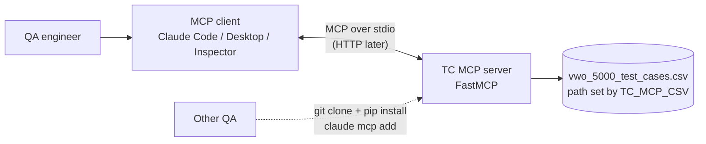
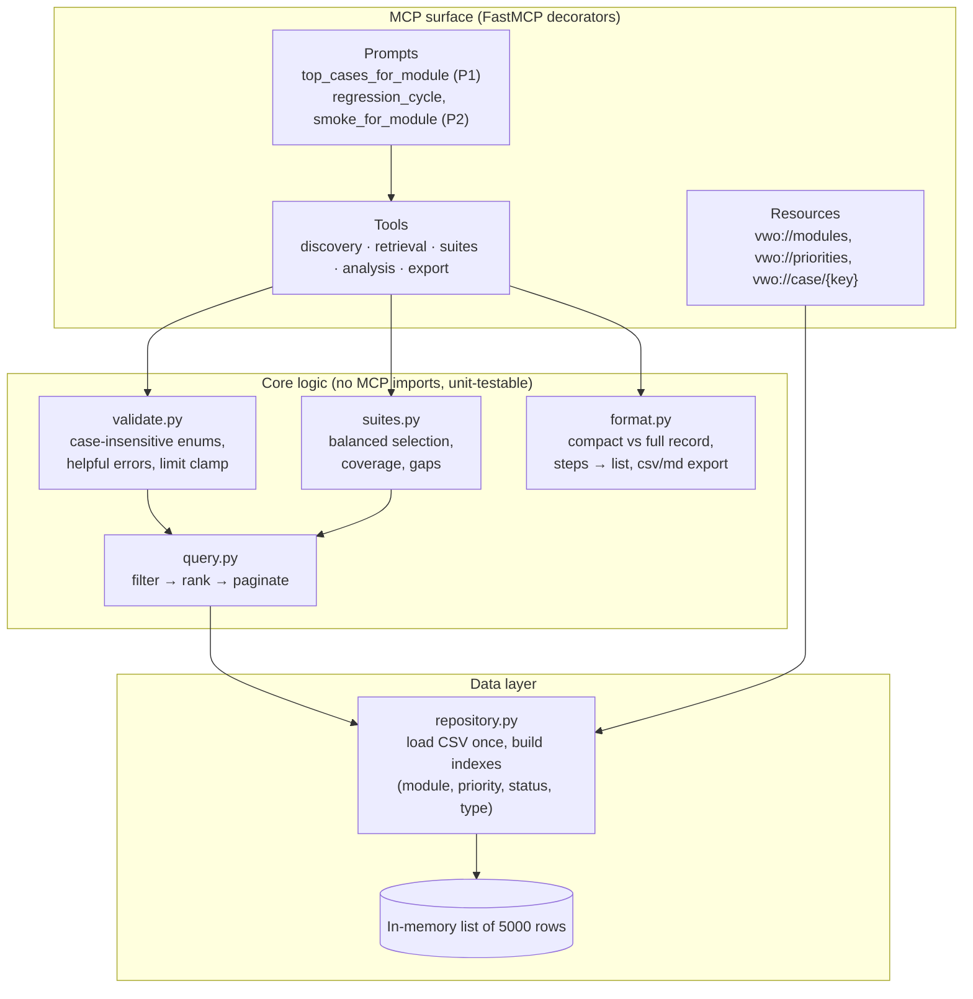

# TestCreator MCP (TC MCP) – Plan

Status: **decisions confirmed, no code yet.** (v3: read-only scope, pure-priority ranking, tool list kept.)

**Confirmed decisions**
- "Creator" = **read-only**: the server only pulls from the CSV; nothing is created, updated or written back.
- **Tool list is kept** (all read-only tools below).
- **"Top test cases" = purely priority order** (Highest > High > Medium > Low, then Issue Key). No balancing across test types.

## 1. Goal
A shareable MCP server (built with **FastMCP**) that lets any QA ask Claude (or another MCP client) for test cases from the VWO library: by priority, by module, with min/max limits, so they can quickly get "the top test cases to execute for module X", and go further: build smoke/regression suites, see coverage gaps, and find automation candidates.

## 2. What the data looks like (`data/vwo_5000_test_cases.csv`)
5000 rows, one per test case. All `Issue Type = Test`; keys run VWO-1001 onward.

| Column | Notes |
|---|---|
| Issue Key, Summary, Description | Summary is `[Module] Type: action`. |
| Priority | Highest 396 · High 1546 · Medium 2198 · Low 860 |
| Component | **= "module"**. 17 values, ~265–335 cases each: SmartCode, Funnels, Reports, User Management, Surveys, Session Recordings, Feature Rollout, Form Analytics, SDK / Server-Side API, Multivariate Testing, Goals & Metrics, Personalization, A/B Testing, Split URL Testing, Integrations, Heatmaps, Account & Billing |
| Labels | Space-separated, e.g. `smartcode functional regression` |
| Test Type | Functional 1516 · Negative 810 · UI/UX 515 · API 415 · Boundary 406 · Regression 379 · Security 368 · Accessibility 321 · Performance 270 |
| Preconditions, Steps, Expected Result | Steps are one string, numbered, separated by ` \| `. |
| Browser, Device | Chrome 148 / Safari 19 / Edge 148 / Firefox 141; desktop / tablet / mobile (iOS) / mobile (Android) |
| Status | Ready 2234 · Automated 1594 · Draft 757 · Deprecated 415 |

Implications: data is clean and categorical, so exact-match filters are enough. Priority is text, so it needs an explicit ranking. Deprecated rows should not be recommended. A full row is large, so list tools return compact rows.

## 3. Decisions to confirm (my recommendations)
1. **Module = Component column.** Case-insensitive matching; unknown values return an error listing the valid ones.
2. **Priority ranking** Highest > High > Medium > Low; ties broken by Issue Key so results are stable.
3. **"Min and max limitations"** supports both: a priority band (`min_priority` / `max_priority`) and a result-count limit (`limit`, default 10, max 100).
4. **Deprecated excluded by default**; opt in explicitly.
5. **"Top test cases to execute"** = filter, then rank by priority, optionally narrowed by status, test type, browser, device.
6. **Strictly read-only.** No write tools, no CSV modification. (`export_test_cases` only writes a new output file, never the source data.)

## 4. Architecture

### 4.1 System context


### 4.2 Inside the server


### 4.3 Request flow: "top 5 Ready cases for Heatmaps"
```mermaid
sequenceDiagram
    participant U as QA
    participant C as Claude (MCP client)
    participant S as TC MCP
    participant D as In-memory data
    U->>C: Top 5 Ready cases for Heatmaps, High or above
    C->>S: get_top_test_cases_for_module(module="Heatmaps", limit=5, min_priority="High", status="Ready")
    S->>S: validate inputs (normalise case, check enums)
    S->>D: filter module/status/priority band
    D-->>S: matching rows
    S->>S: sort by priority rank, then key; cut to limit
    S-->>C: {total_matches, returned, test_cases[]}
    C-->>U: Ranked list with keys and summaries
```

### 4.4 Ranking rule


### 4.5 Project layout
```
MCP_Create_VIBE/
  data/vwo_5000_test_cases.csv
  tc_mcp/
    server.py        # FastMCP app: registers tools/resources/prompts
    tools/           # discovery.py retrieval.py suites.py analysis.py export.py
    core/            # repository.py validate.py query.py suites.py format.py
  tests/             # in-memory FastMCP Client tests
  requirements.txt   # pinned fastmcp
  README.md
```
Design rule: tool functions are thin; all logic lives in `core/` so it can be tested without MCP. The data layer exposes no write methods.

## 5. Tool catalogue (25 read-only tools, grouped, with phase)

All list tools return `{total_matches, returned, test_cases[]}` so the caller knows whether `limit` cut results off.

### A. Discovery (P1)
| Tool | Purpose |
|---|---|
| `list_modules` | Modules with case counts. |
| `list_priorities` | Priorities in rank order with counts. |
| `list_test_types` | Test types with counts. |
| `list_statuses` | Statuses with counts. |
| `list_browsers_devices` | Browsers and devices with counts. |
| `get_data_info` | CSV path, row count, load time, schema; handy for debugging a shared install. |
| `get_summary_stats(module?)` | Counts by priority, test type and status for a module or all. |

### B. Retrieval (P1)
| Tool | Purpose |
|---|---|
| `get_test_case(issue_key)` | One full case, steps as a list. |
| `get_test_cases_by_keys(keys[])` | Bulk fetch (e.g. a list pasted from Jira). |
| `get_test_cases_by_priority(priority, limit, status?)` | Exact priority. |
| `get_test_cases_by_priority_range(min_priority, max_priority, module?, limit)` | The min/max band. |
| `get_test_cases_by_module(module, limit, priority?, test_type?, status?)` | Everything in a module, highest priority first. |
| `get_test_cases_by_test_type(test_type, module?, limit, min_priority?)` | e.g. all Security cases for Billing. |
| `get_test_cases_by_status(status, module?, limit)` | e.g. Draft cases needing review. |
| `get_test_cases_by_label(label, module?, limit)` | Label filter (`regression`, `smartcode`...). |
| `get_test_cases_by_environment(browser?, device?, module?, limit)` | e.g. everything for Safari on iOS. |
| `search_test_cases(query, module?, limit)` | Keyword over summary, description and labels. |
| `get_related_test_cases(issue_key, limit)` | Same module and feature as a given case (siblings across types/devices). |

### C. Headline and suite building (P1 → P2)
| Tool | Purpose |
|---|---|
| `get_top_test_cases_for_module(module, limit, min_priority?, status?, test_type?, browser?, device?)` | **Ranked top-N to execute for a module.** |
| `get_top_test_cases_overall(limit, min_priority?, status?)` | Top N across all modules. |
| `build_smoke_suite(module, limit)` | Highest/High, Ready, Functional first, one case per feature. |
| `build_regression_suite(module?, min_priority, limit)` | Regression-labelled/typed cases ranked by priority. |
| `build_balanced_suite(module, limit)` | Optional, explicit-use only: spreads cases across test types. Not used by any "top" tool, which stay pure priority. |
| `build_cross_browser_suite(module, limit)` | Picks cases so each browser × device combination is hit. |

### D. Coverage and analysis (P2)
| Tool | Purpose |
|---|---|
| `get_coverage_matrix(module?)` | Test type × priority grid of counts. |
| `get_automation_coverage(module?)` | Automated vs manual share per module/priority. |
| `get_automation_candidates(module?, min_priority, limit)` | High-priority Ready cases not yet Automated. |
| `get_coverage_gaps(module)` | Test types with few or no cases for a module, or modules where Highest cases are mostly Draft. |
| `compare_modules(module_a, module_b)` | Side-by-side stats. |
| `find_duplicate_candidates(module?, limit)` | Cases with identical summary/steps (data hygiene). |

### E. Export (P2)
| Tool | Purpose |
|---|---|
| `export_test_cases(filter, format=csv|md|json)` | Writes a file for attaching to Jira or a test cycle. |

### F. Admin (P2)
| Tool | Purpose |
|---|---|
| `reload_data` | Re-read the CSV without restarting the server. |

### Resources and prompts
**P1**
- Resources: `vwo://modules`, `vwo://priorities`, `vwo://case/{issue_key}` so clients can attach data without a tool call. Thin wrappers over the discovery and `get_test_case` logic.
- Prompt: `top_cases_for_module(module, limit?)` guides the model to call `get_top_test_cases_for_module` and present a ranked list (pure priority order).

**P2** (depend on suite tools)
- Prompts: `regression_cycle(module)`, `smoke_for_module(module)`, `release_readiness(modules[])`.

## 6. Phasing
| Phase | Scope | Tools |
|---|---|---|
| P1 (core, matches the original ask) | Discovery + retrieval + headline tool, plus 3 resources and the `top_cases_for_module` prompt | A, B, `get_top_test_cases_for_module` |
| P2 (QA productivity) | Suites, coverage, export, remaining prompts, reload | rest of C, D, E, F |

## 7. Sharing with other QA
- Put the folder in git; README gives 3 steps: `pip install -r requirements.txt`, `claude mcp add vwo-testcases -- python -m tc_mcp.server`, then ask.
- Pin the FastMCP version in `requirements.txt`.
- CSV path configurable via `TC_MCP_CSV` so teammates can use their own export.
- Optional later: package for `uvx`, or host over HTTP for a team.

## 8. Build steps (when we start coding)
1. Scaffold project and install FastMCP.
2. `core/` first: repository, validation, query/rank, with plain pytest tests.
3. P1 tools, then tests via FastMCP's in-memory client (counts sum to 5000, ordering, min/max bands, error messages, limit clamp).
4. Try in MCP Inspector (`fastmcp dev`) and in Claude Code.
5. P1 resources and prompt (thin wrappers), checked in Inspector. Then P2 tools and remaining prompts.
6. README and sharing notes.

## 9. Decisions on earlier open questions
- `limit`: default 10, **max 100** (confirmed).
- **Same CSV for now**; sharing with other QAs' own CSVs is deferred to phase 2. `TC_MCP_CSV` and `reload_data` stay in the plan but are not needed for P1.

## 10. Remaining open question
- Any tools to drop or defer when we reach P2? (Current stance: keep all.)

**Ready to build P1 on your go-ahead.**
